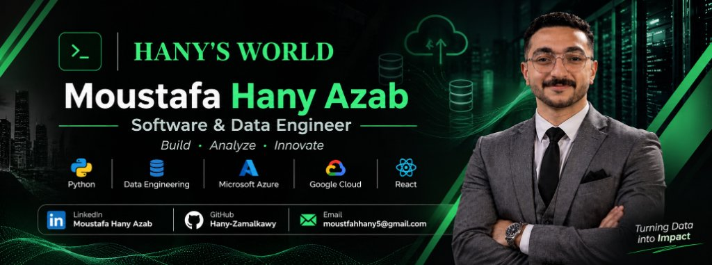

  

    

  
  
  

---

## About Me

I am a **Software & Data Engineer** based in Alexandria, Egypt, with hands-on experience building production backend systems, automated data pipelines, and full-stack web platforms.

**Education:** B.Sc. student in Business Information Systems (BIS) at the Higher Institute for Computer and Information Systems, Abu Qir, Alexandria.

**Industry Programs & Certifications:**

- **Data Engineering Track** at the Digital Egypt Pioneers Initiative (DEPI)
- **Backend AI Engineering Intern** at FlyRank AI (42 production Python/AI deliverables including the Mizan legal pipeline)
- **Python Summer Internship (Team Lead)** at the National Telecommunication Institute (NTI)
- **Database Fundamentals** at the Information Technology Institute (ITI)
- **Anthropic AI Certifications:** Claude API Integration, Model Context Protocol (MCP), and Agent Workflow Design

---

## Featured Projects

| Project | Description | Stack | Links |
| :--- | :--- | :--- | :---: |
| **Mizan** | End-to-end ETL pipeline that scrapes, OCR-parses, and structures Egyptian legislation into clean datasets for downstream AI and analytical workflows. Automated via GitHub Actions. | `Python` `OCR` `Google Drive API` `GitHub Actions` | [Repo](https://github.com/Hany-Zamalkawy/mizan-egyptian-laws-pipeline) |
| **FarmFlow** | Full-stack e-commerce and inventory management system built and deployed as Team Lead during the NTI Summer Internship. Direct farm-to-consumer commerce with relational data persistence. | `Python` `TypeScript` `SQL` | [Repo](https://github.com/Hany-Zamalkawy/Fram_Flow_NTI_Summer_Intership_Project) / [Live](https://hany-zamalkawy.github.io/Fram_Flow_NTI_Summer_Intership_Project/) |
| **HANY'S WORLD** | Interactive engineering portfolio built with React, TypeScript, Tailwind CSS, and Framer Motion. Containerized and deployed on Google Cloud Run. | `React` `TypeScript` `Tailwind CSS` `Cloud Run` | [Repo](https://github.com/Hany-Zamalkawy/Hanys-World-V2-Portfolio) / [Live](https://hany-s-world-597716960036.europe-west2.run.app/) |
| **ATELIER VELIN** | Luxury perfume editorial landing page with modular CSS/JS architecture, native RTL/LTR bilingual support, and zero runtime dependencies. | `HTML5` `CSS @layer` `ES6 Modules` | [Repo](https://github.com/Hany-Zamalkawy/atelier-velin-Landing-Page-) / [Live](https://hany-zamalkawy.github.io/atelier-velin-Landing-Page-/) |
| **VOLT Sports** | Sports performance data analysis and visualization platform with responsive architecture. | `HTML` `CSS` `JavaScript` | [Repo](https://github.com/Hany-Zamalkawy/-VOLT-Sports) / [Live](https://hany-zamalkawy.github.io/-VOLT-Sports/) |
| **FlyRank Backend APIs** | RESTful CRUD microservices built with FastAPI, PostgreSQL, and Docker during the FlyRank AI internship. Full OpenAPI documentation. | `FastAPI` `PostgreSQL` `Docker` | [Week 2](https://github.com/Hany-Zamalkawy/task-api-fastapi-flyrank-internship) / [Week 3](https://github.com/Hany-Zamalkawy/flyrank-internship-task-api-postgres-docker) |

---

## Tech Stack

**Data Engineering & Databases**

**Backend, AI & Automation**

**Frontend & UI**

**Cloud & DevOps**

---

## GitHub Analytics

  
  

---

  <i>"Never give up, get up & complete."</i>

